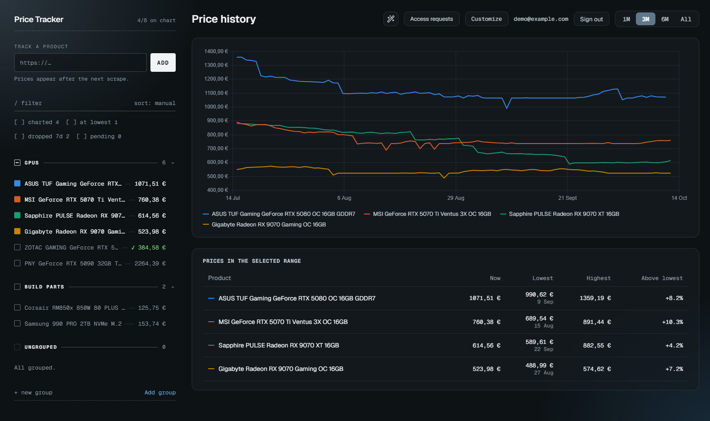
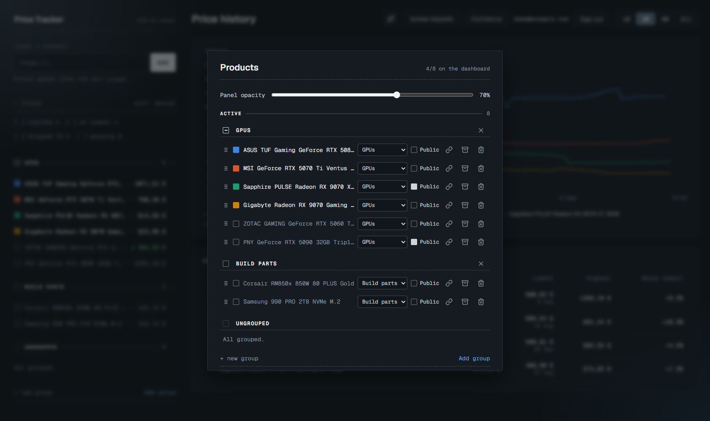
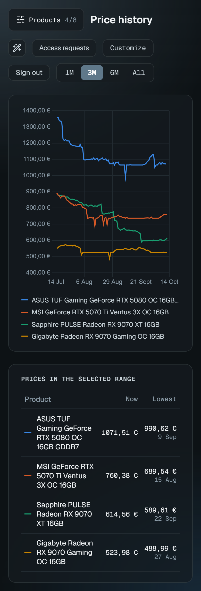
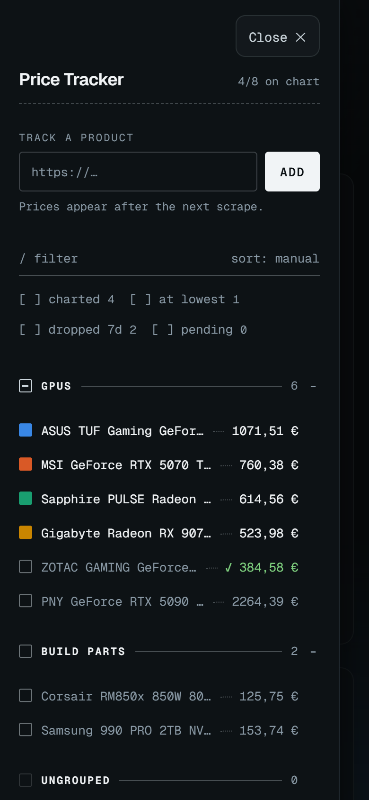
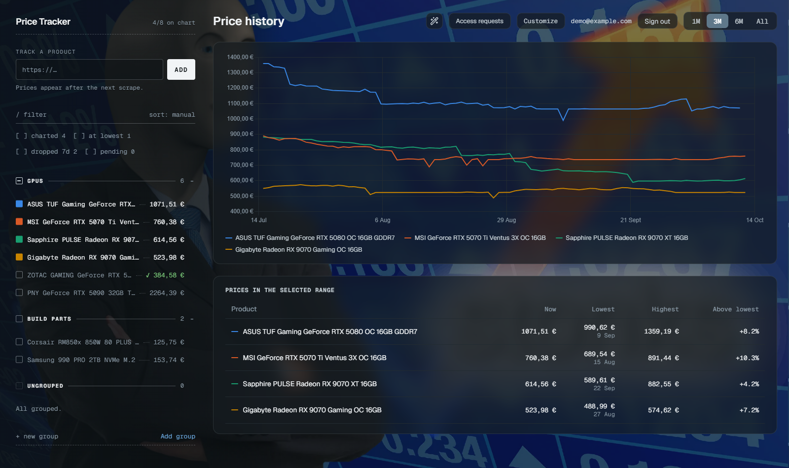
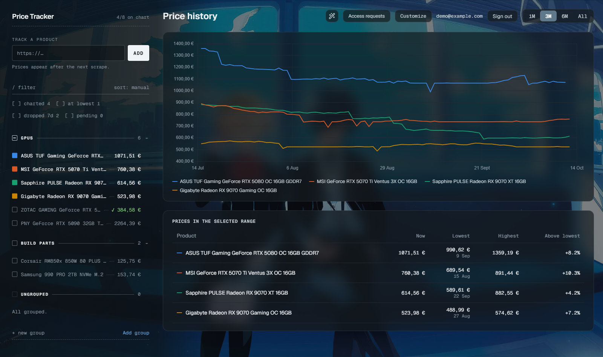
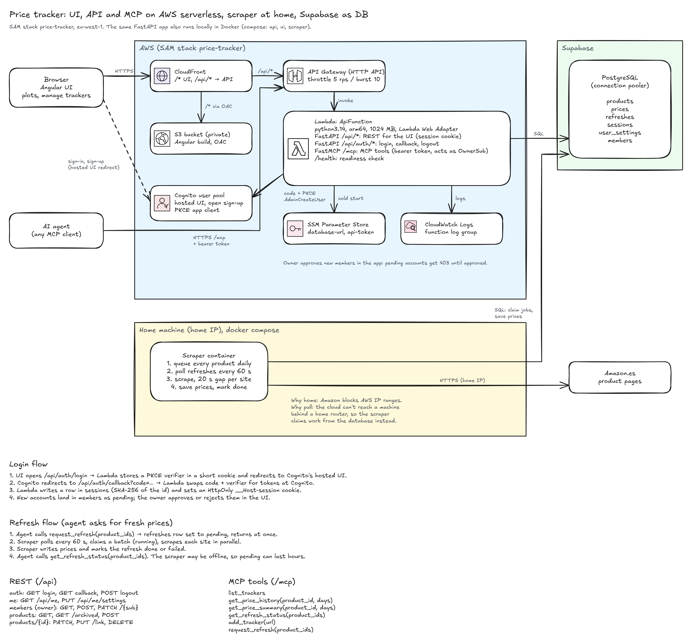

# Price Tracker

Tracks product prices from online shops and charts their history. Add a product link from
the UI or through an MCP agent; a scraper reads the price from the page's schema.org data
or meta tags, with a dedicated parser for Amazon.



> [!WARNING]
> This is a learning project and it is not maintained.
>
> - Amazon answers automated requests with captchas. The scraper spaces its requests out
>   and stops at the first captcha, but after a while most runs end blocked, so expect gaps
>   and failed refreshes. Other shops vary.
> - Amazon's own API is the supported way to get its prices. PA-API 5 was retired in May
>   2026, and its replacement, the [Creators API](https://affiliate-program.amazon.com/creatorsapi/docs/en-us/paapiv5-deprecation),
>   needs an approved Amazon Associates account with recent qualifying sales. A tracker
>   meant for real use should be built on that.
> - The architecture is bigger than the problem on purpose. I used the project to try out
>   AWS services (Lambda, API Gateway, CloudFront, Cognito, SSM, SAM) and MCP. A single
>   small server with a cron job would do the same job.

## Features

- Price history chart and table per product, with 1M / 3M / 6M / all ranges
- Products from any shop that publishes schema.org or Open Graph price data
- Groups, drag-and-drop ordering, filters (at lowest, dropped this week, pending)
- Multi-user: open sign-up with owner approval, private products by default, optional sharing
- MCP server so an agent can list trackers, read history and summaries, add products and
  queue refreshes
- Detects listings that stopped selling and lets the owner move a product to a new link
  while keeping its history
- Custom backgrounds: drop images in `frontend/public/backgrounds/` and the wand button
  cycles through them, saved per user, with adjustable card opacity

| Customize dialog | Mobile |
| --- | --- |
|  |   |

| Background: stonks | Background: Persona 3 |
| --- | --- |
|  |  |

Background images are not included in the repository.

## Architecture



The source is [docs/architecture.excalidraw](docs/architecture.excalidraw); open it at
[excalidraw.com](https://excalidraw.com) to edit.

- One Lambda runs both FastAPI, serving `/api` for the UI, and FastMCP at `/mcp`, through
  the Lambda Web Adapter. Both use the same service layer.
- The backend runs Cognito's OAuth code flow with PKCE itself, so the browser only holds an
  `HttpOnly`, `SameSite=Strict` session cookie. UI and API share one CloudFront origin,
  which leaves no CORS to configure.
- Amazon blocks AWS IP ranges, so the scraper runs on a home machine. It works a queue
  table (`SELECT ... FOR UPDATE SKIP LOCKED`) that agents and the daily schedule both add to.
- Because the scraper sits inside a home network, every URL and every redirect hop must
  resolve to a public address before it fetches the page.

Stack: Python 3.14, FastAPI, FastMCP, SQLAlchemy, Alembic, Postgres · Angular 22, Chart.js
· AWS SAM · uv, nox, ruff, mypy `--strict`, pytest, Vitest.

```
backend/    FastAPI API, MCP server, scraper, DB models and Alembic migrations
frontend/   Angular UI
docs/       architecture diagram, screenshots and ideas
```

## Running it

You need a Postgres database and a Cognito user pool (the SAM stack creates one). See
[backend/README.md](backend/README.md) for local setup, authentication and the optional
AWS deploy, and [frontend/README.md](frontend/README.md) for the UI.

### Docker

`compose.yaml` runs the UI, the API and the scraper. All three read `backend/.env`, so
they use the database configured there.

```bash
docker compose up -d --build scraper   # just the scraper
docker compose up -d --build           # UI on http://localhost:4200, API docs on :8000/docs
docker compose logs -f scraper
docker compose run --rm scraper python -m app.scraper.run --once   # today's run now
docker compose run --rm api alembic upgrade head                    # migrations
docker compose down
```

Port 4200 is the local callback the Cognito app client allows, so stop `npm start` first.

### Scraper

One process works the `refreshes` queue:

- After `PT_SCRAPE_HOUR_UTC` (default 6), every tracked product not yet requested that
  UTC day is queued. A machine that was asleep at that hour catches up when it wakes.
- Products that several users track under the same URL are fetched once.
- Up to `PT_SCRAPE_WORKERS` sites (default 4) are scraped at once; requests to the same
  site stay 20 s apart. A captcha fails the rest of that site's batch without fetching it.
- A page without a price, a block or an HTTP error marks the refresh `failed` with the
  reason, which `get_refresh_status` shows. A restart re-queues anything left `running`,
  so run only one scraper.

## License

[MIT](LICENSE)
